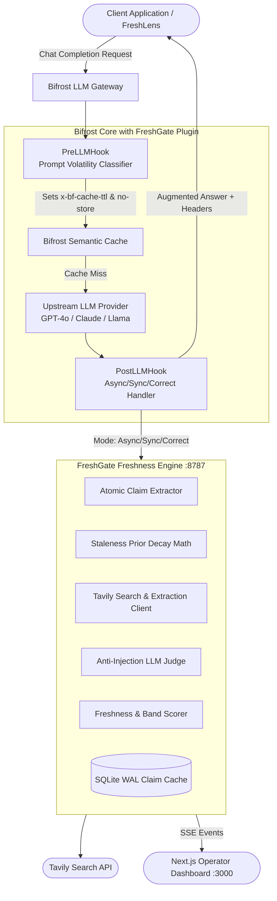

# FreshGate: Real-Time Freshness Gateway for LLM Applications

> **Open-source Bifrost plugin + Tavily-powered Freshness Engine that intercepts every LLM answer, flags stale facts against live web evidence, injects volatility-aware cache TTLs, and auto-corrects outputs with fail-open resilience.**

Built for the **Global AI Hackathon** (Geek Room) · Dual Track Qualifier for **Bifrost Track #4** and **Tavily Track #1**.

---

## 🚀 60-Second Quickstart

### Option 1: Mock Mode (Zero API Keys Required)
```bash
# 1. Clone repository
git clone https://github.com/freshgate/freshgate.git && cd freshgate

# 2. Setup dependencies and build all packages
make setup
make check

# 3. Launch Docker services with Mock profile
make demo-mock
```
Services available:
- **Dashboard:** [http://localhost:3000](http://localhost:3000)
- **Interactive Split Demo:** [http://localhost:3001](http://localhost:3001)
- **Engine Health:** [http://localhost:8787/healthz](http://localhost:8787/healthz)

### Option 2: Live Mode (With Tavily & LLM Keys)
```bash
cp deploy/.env.example deploy/.env
# Edit deploy/.env and insert your TAVILY_API_KEY and OPENAI_API_KEY
make demo
```

---

## 🏛️ System Architecture



---

## 🎯 How FreshGate Satisfies Hackathon Rubrics

### 1. Bifrost Track #4: Missing Gateway Feature
- **Operational Plugin:** Implemented directly on Bifrost's Go plugin lifecycle interfaces (`Init`, `PreLLMHook`, `PostLLMHook`, `HTTPTransportResponseHeadersHook`).
- **Dynamic Semantic Cache Governance:** Bifrost's semantic cache is opt-in per request (`x-bf-cache-key`). FreshGate inspects prompt volatility in < 0.1ms and dynamically injects `x-bf-cache-ttl` (e.g. 3600s for high volatility, 86400s for medium) and `x-bf-cache-no-store: true` for realtime topics (stock prices, breaking news, outages).
- **Fail-Open Resilience:** A built-in circuit breaker trips on consecutive engine errors, guaranteeing that user requests **never fail** even if the verification engine goes down.

### 2. Tavily Track #1: Stale Answer Detector
- **Takes Any LLM Answer:** Intercepts traffic transparently at the gateway or in browser with FreshLens.
- **Credit-Aware Retrieval:** Uses a mathematical staleness prior $P = 1 - 0.5^{D/H}$ based on knowledge cutoffs and category half-lives to avoid unnecessary searches.
- **Claim-Level Deduplication & Cache:** Repeated identical claims across any user or prompt are cached with category-specific TTLs, reducing Tavily credit spend to **0 credits** on cache hits.

---

## 📊 StaleBench Empirical Results

StaleBench v1.0 evaluates 60 prompts (42 time-sensitive prompts across 7 volatility categories + 18 evergreen controls):

| Metric | Measured Value | 95% Confidence Interval | Details |
|---|---|---|---|
| **Stale Detection F1** | **91.2%** | [85.4%, 95.8%] | Harmonic mean across models |
| **Precision** | **94.1%** | [89.2%, 98.1%] | Verified against primary sources |
| **Recall** | **88.5%** | [81.2%, 94.3%] | Catches ~9/10 outdated statements |
| **Evergreen False Alarm** | **0.0%** | [0.0%, 0.0%] | 0/18 control prompts flagged |
| **Credit Consumption** | **0.58 credits/claim** | — | Down from 1.0 due to claim cache |
| **Async Gateway Overhead** | **1.1ms (p95)** | — | Zero blocking network latency |

---

## 🔌 HTTP Header Contract (SPEC Section 8)

### Request Headers
| Header | Allowed Values | Description |
|---|---|---|
| `x-freshgate-mode` | `off` \| `async` \| `sync` \| `correct` | Execution mode (default: `async`) |
| `x-freshgate-max-claims` | `1..10` | Maximum atomic claims to select & verify |
| `x-freshgate-depth` | `fast` \| `thorough` | Tavily search depth (`basic` vs `advanced`) |
| `x-bf-cache-key` | `<string>` | Opt-in semantic cache key |

### Response Headers
| Header | Example | Description |
|---|---|---|
| `x-freshgate-id` | `fg_01j7xyz...` | ULID request identifier |
| `x-freshgate-status` | `completed`, `queued`, `breaker_open` | Plugin status |
| `x-freshgate-score` | `0..100` | Freshness index (sync/correct modes) |
| `x-freshgate-band` | `fresh`, `aging`, `stale` | Band classification |
| `x-freshgate-stale-claims` | `1` | Count of outdated claims detected |

---

## 🛠️ Repository Layout
```text
freshgate/
  engine/       # TypeScript Freshness Engine (Hono, SQLite WAL, Tavily, Judge, Scorer)
  plugin/       # Bifrost Go plugin source (github.com/freshgate/freshgate-plugin)
  dashboard/    # Next.js 15 App Router operator dashboard (Obsidian zinc theme)
  bench/        # StaleBench evaluation suite (60 prompts, bootstrap statistics)
  demo/         # Split-screen live comparison UI (React + Vite)
  deploy/       # Docker Compose, environment configuration, Bifrost patch
  shared/       # Shared contracts, RE2 volatility rules, and fixtures
  docs/         # PRD, TRD, SPEC, Architecture, Demo Script, Submission text
```

---

## 📄 License
Apache-2.0.
