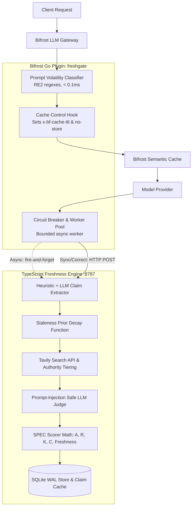
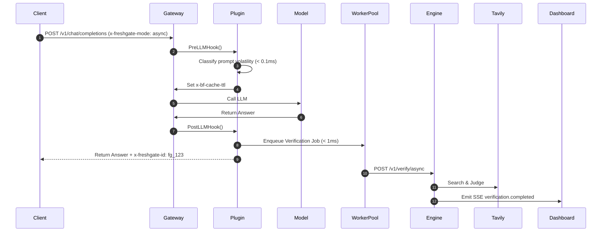
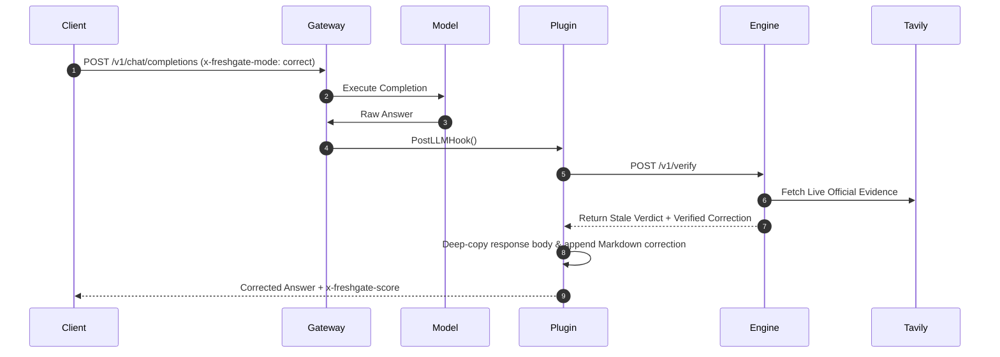
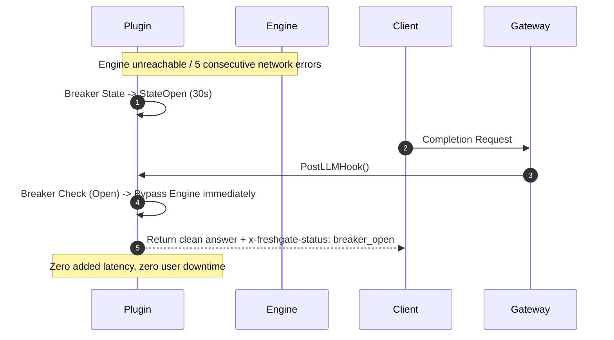

# FreshGate Technical Architecture & Design Decisions

## 1. System Topology & Component Map

FreshGate decouples the gateway execution path from heavy verification logic:

---

## 2. Sequence Diagrams

### 2.1 Asynchronous Mode (Default Production Path)

### 2.2 Correct Mode (Auto-Correction Path)

### 2.3 Fail-Open Circuit Breaker Recovery

---

## 3. Fundamental Design Decisions & Trade-Offs

### 1. Why an LLM Gateway Plugin rather than an SDK wrapper?
- **Zero Code Changes:** Enterprise engineering teams cannot rewrite thousands of prompts or SDK calls. By deploying FreshGate as a Bifrost gateway plugin, every internal application routed through Bifrost automatically receives freshness tracking, TTL optimization, and hallucination defense without touching a single line of app code.
- **Hook Sequencing Power:** Running as `pre_builtin` allows FreshGate to govern Bifrost's semantic cache TTL *before* the cache layer processes the query.

### 2. Why a Mathematical Staleness Prior ($P = 1 - 0.5^{D/H}$)?
- Verifying every single statement against the web wastes search credits and introduces latency.
- Stable/evergreen facts (math definitions, historical events, chemical structures) have infinite half-life ($H = \infty$), yielding prior $P = 0$. FreshGate skips them with status `skipped_evergreen`, preserving Tavily credits for rapidly decaying facts (pricing tiers, software releases, leadership changes).

### 3. Why Claim-Level Caching instead of Full-Answer Caching?
- Two completely different prompts ("What is Next.js 14 pricing?" and "Tell me about Next.js and ChatGPT Plus") share the identical claim: `Next.js 14 is the latest version`.
- By computing `sha256(normalized_claim + "|" + category)`, verified claims are shared across the entire organization, delivering **0 Tavily credit cost** on repeat queries.
