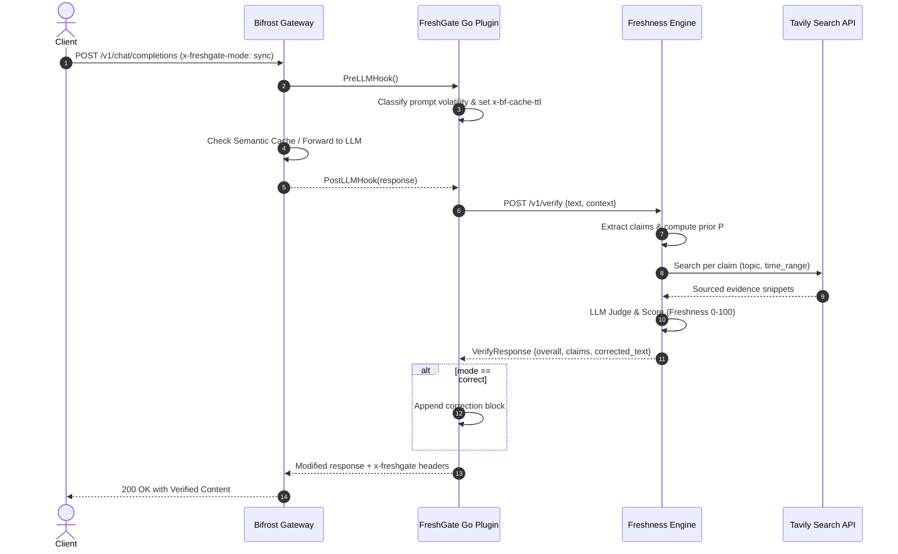
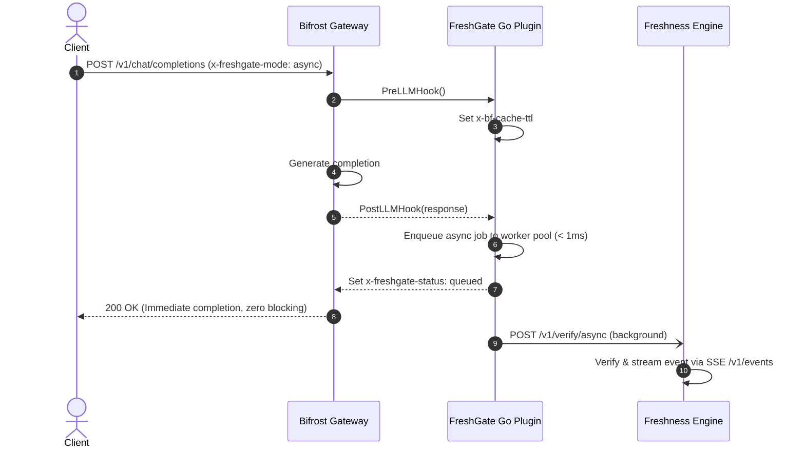
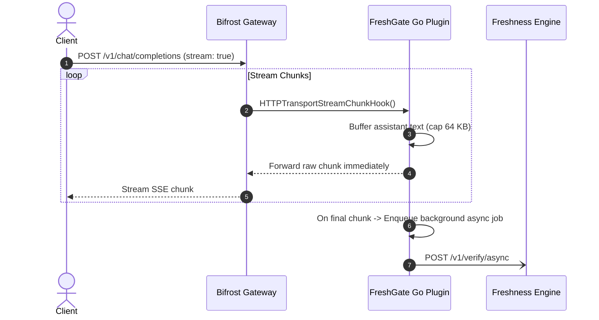

# FreshGate Technical Requirements Document (TRD)

## 1. System Architecture & Boundaries
FreshGate consists of:
1. `plugin/freshgate`: Go plugin for the Bifrost gateway implementing `PreLLMHook`, `PostLLMHook`, and `HTTPTransportResponseHeadersHook`.
2. `engine/`: TypeScript / Hono microservice handling claim extraction, prompt classification, Tavily search, LLM judging, and scoring.
3. `dashboard/`: Next.js 15 App Router operator dashboard with live SSE telemetry and analytics.
4. `bench/`: StaleBench evaluation suite.

---

## 2. Sequence Diagrams

### 2.1 Synchronous Flow (`x-freshgate-mode: sync` or `correct`)

### 2.2 Asynchronous Flow (`x-freshgate-mode: async`)

### 2.3 Streaming Flow (`stream: true`)

---

## 3. Failure Modes & Resilience
- **Engine Down / Unreachable:** Plugin circuit breaker trips after 5 consecutive failures. Requests immediately fail-open with `x-freshgate-status: breaker_open`.
- **Tavily 429 Rate Limit:** Engine respects `Retry-After` header (up to 2 retries) and degrades to `status: rate_limited` without crashing.
- **Tavily 434 Capacity Limit:** When `max_age_hours` returns 434 on non-paying tier, engine retries query once without `max_age_hours`.
- **Hourly Budget Exhaustion:** When hourly Tavily credits exceed `TAVILY_CREDIT_BUDGET_PER_HOUR`, claims are marked `budget_exhausted` and return score `55 * (1 - P)` with verdict `unverifiable`.

---

## 4. Performance Budgets
- **Async Gateway Overhead:** P95 latency overhead $< 2\text{ ms}$.
- **Prompt Classification Latency:** $< 2\text{ ms}$ (zero network calls, pure RE2 regex matching).
- **Sync Mode Gateway Timeout:** Hard bounded by `timeout_ms` (default 4000ms); degrades to async on timeout.
- **Claim Cache Lookup:** $< 5\text{ ms}$ via indexed SQLite lookup.
